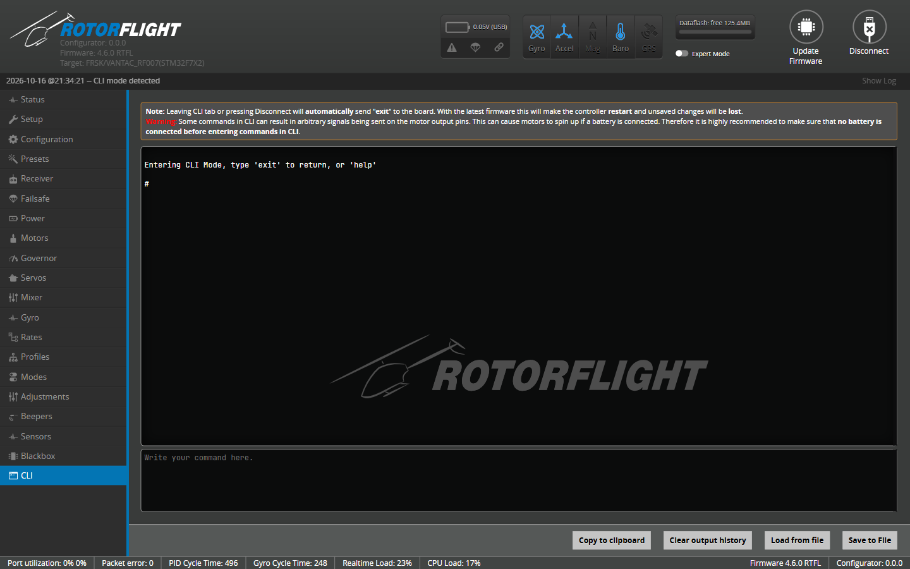

# Backup & Restore

A backup is a text file of CLI commands that recreates your configuration.
Take one before every firmware update, before big tuning changes, and as
soon as a new helicopter flies well. Backups are also the easiest way to
share a setup or move it to another flight controller.

## Taking a backup

1. Open the [CLI](../configurator/tabs/cli.md) tab and click **Clear output
   history**.
2. Type `diff all` (or another command from the table below) and press
   Enter.
3. When the output stops, click **Save to File** and choose where to save
   it.

### Which command?

| Command | Contains |
| --- | --- |
| `diff all` | Every setting that differs from the defaults, for all PID and rate profiles. **The best choice for backups** -- small, easy to read, and it survives firmware updates best. |
| `diff` | As above, but only for the currently selected profiles. |
| `dump all` | Every setting, changed or not, for all profiles. Large; useful for comparing two boards side by side. |
| `dump` | Every setting for the current profiles only. |
| `diff hardware` / `dump hardware` | Only the board hardware setup: pin assignments (`resource`), timers, DMA. |

!!! tip "Name your backups"
    Include the helicopter, firmware version and date in the file name, for
    example `goblin-700_rf2.3.0_2026-10-08.txt`. You'll thank yourself after
    the next update.

## Restoring a backup

1. Open the CLI tab and click **Load from file**.
2. Pick the backup file. The Configurator shows the commands so you can
   check, and edit, them before they run.
3. Click **Execute**.
4. When it has finished, type `save` and press Enter. The flight controller
   saves the settings and reboots.

!!! warning "Restoring onto a newer major version"
    A `diff all` from an older release may contain settings that have been
    renamed or removed, or whose meaning has changed. Unknown commands are
    reported as errors and skipped; the rest are applied. Check the
    [Upgrade Notes](upgrade-notes.md) for anything that has to be set up
    again by hand, and look through the result before you fly.

The same steps load board configuration snippets -- for example the
[resource remapping](../setup/remapping.md) for a Betaflight flight
controller -- or setups shared by other pilots.
