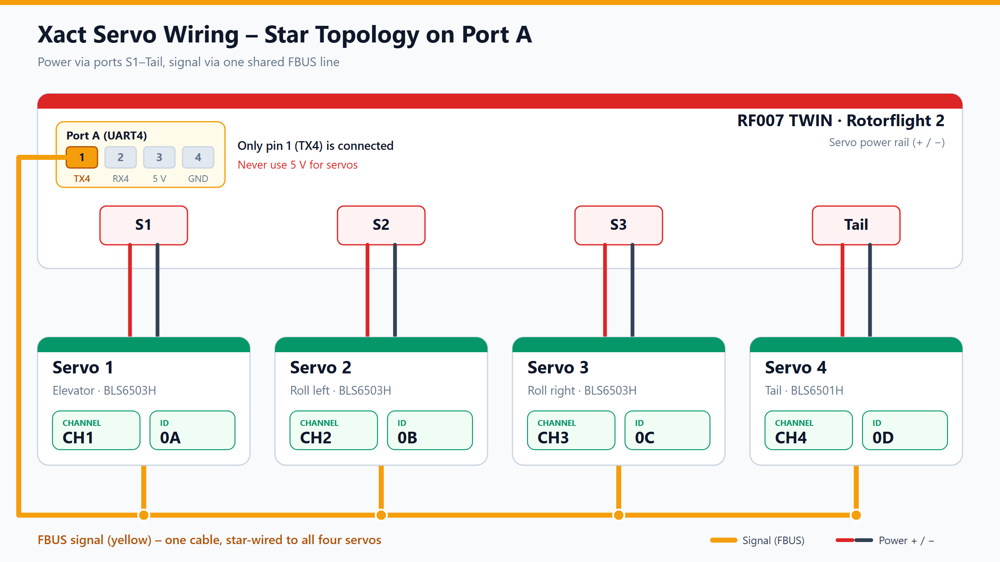
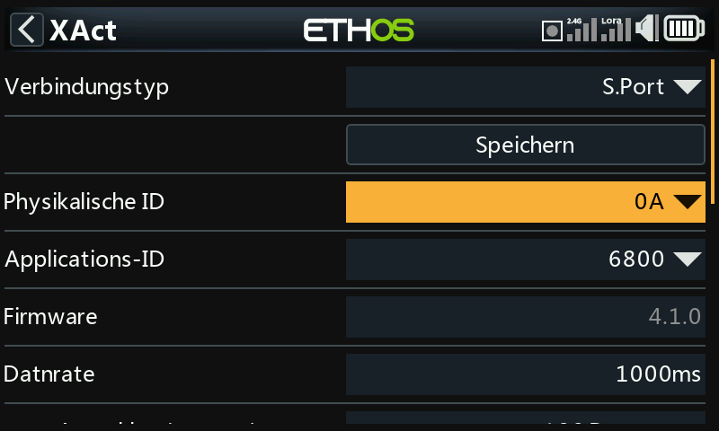

# FrSky Servos

FrSky XACT servos, such as the BLS6503H for the swashplate and the BLS6501H
for the tail, can run on a single **F.Bus** wire. That one wire carries the
control data from the flight controller to the servos and their telemetry
back. Power comes from the servo ports as usual.

This guide covers the bus wiring, programming each servo, and checking the
bench before the blades go on. The settings themselves are explained on
their own pages, linked below.

!!! danger "Blades off"
    Keep the main and tail blades off until every servo has passed the
    checks in [section 6](#6-checks-before-the-blades-go-on).

!!! warning "Program one servo at a time"
    FrSky servos ship with the same Physical ID (`0A`, sometimes `0C`) and
    channel `CH1`. Two servos with the same ID on the bus answer each other's
    telemetry requests, and a save can overwrite all of them at once. Connect
    each new servo alone, assign its ID and channel, save it, and only then
    join it to the bus.

## What you need

- A flight controller with a free UART for F.Bus. This guide uses the
  **UART4** port (Port A) of the [VANTAC RF007 TWIN](../hardware/frsky-007.md).
- Rotorflight 2.4 or later, with the [Configurator](../configurator/index.md).
- Four XACT servos, one per swashplate and tail function, and a way to
  connect them one at a time.

## 1. Wiring

Each servo uses two connections:

- **Power** comes from the servo port on the flight controller, through the
  usual red (+) and black (−) lead. Servo 1 goes to **S1**, servo 2 to **S2**,
  servo 3 to **S3** and servo 4 (tail) to **Tail**. The ports share one
  power rail.
- **Signal** is the F.Bus wire. Only **pin 1 (TX4)** of Port A is connected.
  Pins 2 to 4 stay free. The yellow signal wires of all servos join at one
  star point, which is fed from Port A pin 1.



!!! danger "Power servos only from the servo ports"
    Leave Port A pins 2 to 4 unconnected. Do not run a servo from any Port A
    pin, including the 5 V pin shown in the wiring diagram.

Use the same plugs and servo leads you would for PWM. The signal pin of the
servo ports is not used, because the servos take their control data from the
F.Bus wire.

## 2. Programming the servos

!!! warning "Set 180° and check the angles before installation"
    With the total travel at 120°, the angles Rotorflight calculates do not
    match the servo positions. Set **Max. travel, total** to `180 Degree` on
    every servo, and check each servo's angle **before** it goes into the
    helicopter. The procedure is in [Servo Setup](servos.md#4-calibrate-the-throw-recommended).

    This is the author's finding from the test helicopter. The cause is not
    checked against the firmware source.

Each servo needs two addresses, set one servo at a time:

| Servo | Function | Channel | Physical ID (hex) | Physical ID (CLI, decimal) |
| :-- | :-- | :-- | :-- | :-- |
| 1 | Elevator | `CH1` | `0A` | 10 |
| 2 | Roll left | `CH2` | `0B` | 11 |
| 3 | Roll right | `CH3` | `0C` | 12 |
| 4 | Tail | `CH4` | `0D` | 13 |

- **Channel** says which control channel the servo answers to.
- **Physical ID** is the unique bus address used for telemetry. The valid
  range is `00` to `1A`.

### 2.1 Configurator (recommended)

1. Set UART4 to **F.BUS** (see [section 3](#3-serial-port-and-telemetry-in-the-configurator)).
2. Connect a single servo to the bus and open the
   [XACT Servo Programming](../configurator/tabs/xact-servo.md) tab.
3. Disarm, then click **Scan for Servos**.
4. Select the servo, set its Physical ID and channel, and write the change.
5. Disconnect it, connect the next servo, and repeat.

The tab needs a link on Port A. Every servo that ends up on the bus must have
its own ID before you join it to the star.

### 2.2 Transmitter (Ethos)

FrSky's XAct Lua script adds a servo menu to Ethos radios under
**System → Device Config**. Install it with the FrSky Suite (2.0 or later),
under **Lua library**. It programs a servo that is connected directly to the
transmitter or receiver. Whether it can also reach a servo on the
flight controller's Port A is not verified for this guide, so use the
Configurator route above for bus servos.

The entry is under **System → Device config → Servos → XAct**.


*Ethos Device config → Servos → XAct (German UI).*

The XAct screen below was read from a servo, with the values as shown on the
radio. The table gives the values used on the test servos as a starting point:

| Setting | Value |
| :-- | :-- |
| Physical ID | `0A` to `0D`, one per servo |
| Application ID | `6800` (leave unchanged) |
| Data rate | `1000 ms` |
| Max. travel, total | `180 Degree` |
| Direction | `Clockwise` |
| Working range | `Angle mode` (not continuous rotation) |
| Channel | `CH1` to `CH4` |
| Channel center | `0` |
| Holding force | `0.4` |
| Smoothing | `1` |
| Dead zone | `3` |


*Ethos XAct menu, read from the servo (German UI).*


*Ethos XAct parameters, read from the servo (German UI). The photo shows the
previous 120° setting; use 180° as in the table above.*

## 3. Serial port and telemetry in the Configurator

1. Open the [Configuration](../configurator/tabs/configuration.md) tab.
2. Set **UART4** to **F.BUS**.
3. Click **Save and Reboot**.

The F.Bus master is described in [FBUS Master](fbus-master.md).

## 4. Forwarding servo telemetry to the radio

Telemetry from the servos only reaches the radio if the flight controller
forwards it. Forwarding is set by the physical IDs in
`fbus_master_forwarded_sensors`. Up to eight IDs fit, and `255` means an
unused slot. Out of the box no IDs are forwarded.

In the CLI tab, enter the decimal IDs of all four servos:

```text
set fbus_master_forwarded_sensors = 10, 11, 12, 13, 255, 255, 255, 255
save
```

Check the result with the `fbus_sensors` command. Each servo should appear
in the table with **Forwarded** set to `yes`:

```text
fbus_sensors
```

On the transmitter, run **Model → Telemetry → Discover sensors**. The radio
then lists the sensors of the servo, named `SRV1` for the first one:


*Ethos telemetry page after discovery, with live values from the servo
(German UI).*

The flight controller itself decodes three values from the servo frame:
current, voltage and temperature (`fbusServoConvertData` in
`src/main/drivers/fbus_sensor.c`).

!!! note "Telemetry needs a telemetry-capable receiver link"
    Forwarded sensors reach the radio over the receiver link. For the F.Bus
    receiver setup, see [Receiver](../configurator/tabs/receiver.md) and
    [Telemetry](../reference/telemetry.md).

## 5. Bus servos and the mixer

Once the servos answer on the bus, the Configurator assigns them to the
mixer:

- The [Servos](../configurator/tabs/servos.md) tab, *Bus Servo Configuration*,
  sets each bus output's source. **Mixer** drives the servo from the
  swashplate and tail mixer. **RX** passes a receiver channel straight
  through, for example for lights.
- The [Mixer & Swashplate Setup](mixer.md) guide sets the swashplate type
  and the direction of each servo.

## 6. Checks before the blades go on

Before this, check the servo angles as the warning in [section 2](#2-programming-the-servos) describes.
Then run these with the motor disarmed and the blades off:

1. **Stick direction.** Positive pitch moves all three swashplate servos
   evenly. Elevator forward tilts the swashplate forward. Roll right tilts it
   right. Tail right moves the tail servo in the expected direction.
2. **Gyro counter-steer.** Tilt the helicopter forward. The swashplate
   counter-steers backwards. Roll it left. The swashplate counter-steers
   right. Swing the tail left. The tail counter-steers right.
3. **Full travel.** Apply full collective pitch and move the cyclic stick in
   a full circle. Watch the servo current telemetry. A large rise at one
   point means the linkage binds, and the cyclic limits in the mixer need to
   be reduced.
4. **Soft start.** Power off, move the swashplate gently by hand, then power
   on. The servos must move to neutral smoothly and must not jerk.

## Troubleshooting

| Problem | Try |
| :-- | :-- |
| No servos found by **Scan for Servos** | Check the UART4 setting, the single signal wire, and that the servo is powered. |
| Two servos appear as one | Two servos share an ID. Re-program them one at a time. |
| `fbus_sensors` shows the servos, but `Forwarded` is `no` | Check the `fbus_master_forwarded_sensors` line and save again. |
| Telemetry shows nothing on the radio | Run **Discover sensors** on the transmitter again. |
