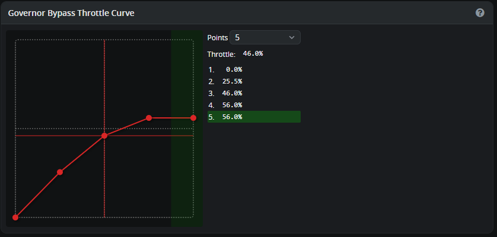
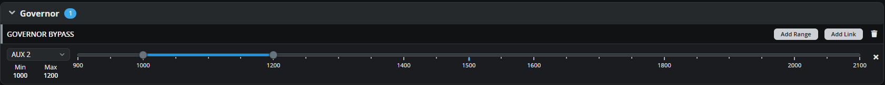
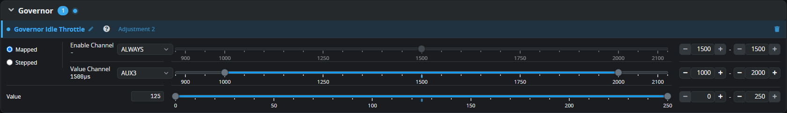

# Nitro Helicopters

Rotorflight's **NITRO** governor flies nitro and petrol helicopters: the
flight controller drives the throttle servo and holds the headspeed from an
RPM sensor.

!!! danger
    An engine can't be stopped by disarming as quickly as an electric motor.
    Make sure **Motor Off** really closes the carburettor fully, and always
    have a way to stop the engine by hand.

## 1. RPM sensor

Fit a magnetic RPM sensor (hall sensor) on the engine fan or clutch, and
connect it to the flight controller's frequency input. On the
[Motors](../configurator/tabs/motors.md#rpm) tab:

- Turn on **RPM Sensor**.
- Set the **Main Rotor Gear Ratio** from the engine to the main rotor (for a
  two-stage gearbox see [Gear Ratios](gear-ratios.md)), and the **Tail Rotor
  Gear Ratio**.
- **Main Motor Pole Count**: **2** for one magnet. (The setting counts
  poles; one magnet gives one pulse per revolution, like one pole pair.)

## 2. Throttle servo

Plug the throttle servo into the **ESC / Motor 1** output. On the Motors
tab:

1. **Throttle Protocol**: PWM. The default **Update Frequency** of 250 Hz
   suits most digital servos; use 50 Hz for analogue servos.
2. Start with a safe, narrow range so the servo can't bind:

    | Setting | Start at | Becomes |
    | --- | --- | --- |
    | **Motor Off** | 1300 µs | Carburettor **fully closed** -- engine cut |
    | **Low Throttle** | 1500 µs | Lowest usable throttle (0%) |
    | **High Throttle** | 1700 µs | Carburettor **fully open** (100%) |

3. Connect the flight battery. The servo goes to Motor Off. Adjust **Motor
   Off** in small steps until the barrel is fully closed without the servo
   straining. (If the servo moves the wrong way, swap the Motor Off and High
   Throttle values -- or reverse the servo.)
4. Set **Low Throttle** about 100 µs above Motor Off.
5. Use **Throttle Override** at 100% and adjust **High Throttle** until the
   barrel is fully open, without binding. **Live Update** applies the
   changes immediately.

!!! note "Low Throttle is not idle"
    Set Low Throttle so the engine *won't* keep running there -- below a
    real idle. The idle itself is set with **Idle Throttle** on the
    Governor tab (or in your radio). This keeps the 0-100% range linear,
    which the governor needs.

## 3. Governor

On the [Governor](../configurator/tabs/governor.md) tab:

- **Governor Mode**: NITRO.
- **Throttle Type**: NORMAL is the usual choice for nitro.
- **Idle Throttle**: a reliable idle, with the clutch not engaging.
- **Handover Throttle**: above the point where the clutch fully engages --
  often 40-50%. Spool up by hand below handover (throttle on a slider or
  your collective stick), and the governor takes over above it.

Set the **Full Headspeed** on the [Profiles](../configurator/tabs/profiles.md#governor-settings)
tab, then see [Governor Setup](governor-setup.md#4-test) to test, and
[Governor Tuning](../tuning/governor.md).

## Optional

### Use governor-bypass (Direct throttle with collective stick)
First setup the Governor Bypass Throttle Curve at governor setup:

Go to Modes and assign a channel to the governor bypass mode. In this case the same channel is used as for profile switching. This way you free up a channel and you have automatically in profile 1 the Governor Bypass Throttle curve (Direct throttle).

### Idle adjustment from the radio
With adjustments you can now easily add a adjustment for nitro idle adjustment. From the radio you can use a knob or a trim switch to increase or decrease the idle rpm of the engine. It will change the throttle idle value in governor setup.

Go to adjustments and search for Governor Idle Throttle 

Now on your radio add a channel (in this example ch7)  with a range from 1000us - 2000us and assing it to a slider or knob.

